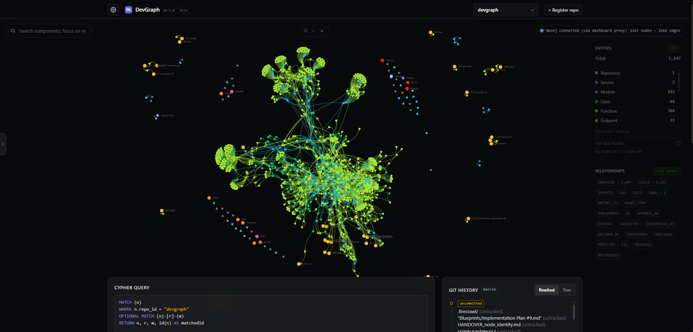

# DevGraph

A local-first, live-updating knowledge graph for codebases. DevGraph indexes explicitly registered repositories into Neo4j so coding assistants can query structure, dependencies, history, and design context without repeatedly scanning the whole tree.

It provides:

- purpose-built MCP tools for callers, impact, architecture, source, recency, requirements, mentions, and repository history;
- a CLI for setup, repository management, diagnostics, export, and MCP registration;
- a loopback-only dashboard for exploring the graph, git history, query results, and saved layouts; and
- a background watcher that keeps registered repositories current as files and git state change.



Source extraction is selected per file, so one repository can mix **Python, JavaScript/TypeScript, C#, C++, Java, Kotlin, Rust, and Go**. DevGraph also recognizes container/compose files, API routes (Python, Express-style JavaScript/TypeScript, Spring, ASP.NET Core and Go), datastore usage (in Python, JS/TS, Java, Kotlin, C# and Go source; see [Current limitations](#current-limitations)), Markdown annotations and mentions, and local git history.

## Quickstart

### Linux

Requires Python 3.13 or newer, Git, [uv](https://docs.astral.sh/uv/), and Podman or Docker:

```bash
git clone https://github.com/HaydenSchmidtDOC/DevGraph.git && cd DevGraph
uv sync --extra dev
podman run -d --name devgraph-neo4j --restart=always \
  -p 127.0.0.1:7474:7474 -p 127.0.0.1:7687:7687 \
  -e NEO4J_AUTH=neo4j/devgraph-local-dev \
  -v devgraph_neo4j_data:/data -v devgraph_neo4j_logs:/logs \
  docker.io/library/neo4j:5.26-community
uv run devgraph doctor --wait 90
uv run devgraph register ~/code/my-repo --full
uv run devgraph mcp add
```

`docker run` takes the same arguments. A new Neo4j container takes about 20 seconds before it answers, so `doctor --wait 90` first waits up to 90 seconds for it (saying so every 10 seconds); `register` run before then fails its initial scan. `devgraph mcp add` registers DevGraph with Claude Code for every project (user scope); `devgraph client-config` prints the VS Code entry. Activate the environment (`source .venv/bin/activate`) to drop the `uv run` prefix. On CPython for Windows, macOS and Linux x86_64/aarch64 the install includes `neo4j-rust-ext`, the Neo4j driver's faster Rust encoder (about a fifth off a full scan); elsewhere it is left out and the pure-Python driver is used. Without a desktop tray, the agent runs headless (see `devgraph tray start` below).

### Windows

The interactive installer targets Windows PowerShell and requires Python 3.13 or newer, Git, and [Podman](https://podman.io/):

```powershell
irm https://raw.githubusercontent.com/HaydenSchmidtDOC/DevGraph/master/scripts/install.ps1 | iex
```

It clones DevGraph, creates its Python environment, starts Neo4j, waits up to 90 seconds for it to answer, verifies the installation, and offers to register DevGraph with detected Claude Code and VS Code clients.

From an existing clone, run:

```powershell
.\scripts\setup-menu.ps1
```

DevGraph never discovers repositories automatically. Register each repository explicitly; `register` defaults to the current directory and `add` remains an alias:

```powershell
devgraph register C:\path\to\repo --full
devgraph list
devgraph dashboard
```

Registration runs the initial source scan. `--full` also indexes local git history so recency queries work immediately.

## Common commands

Run `devgraph --help` or `devgraph <command> --help` for the complete, current interface.

| Task | Command |
|---|---|
| Register and initially index a repository | `devgraph register [path] [--full]` |
| Refresh source and reconcile git history | `devgraph rescan <repo_id> [--full] [--force]` |
| Inspect registered repositories | `devgraph list`, `devgraph info <repo_id>`, `devgraph stats [repo_id]` |
| Check installation and graph health | `devgraph status`, `devgraph doctor`, `devgraph self-test [repo_id]` |
| Unregister a repository and delete its graph | `devgraph remove <repo_id> [--keep-graph]` |
| Recompute communities, key nodes and bridges | `devgraph insights <repo_id>` |
| Open the dashboard | `devgraph dashboard` |
| Start, check or stop the background agent | `devgraph tray start`, `devgraph tray status`, `devgraph tray stop` |
| Configure an MCP client | `devgraph client-config`, `devgraph mcp add` (Claude Code, user scope: every project), `devgraph mcp doctor` |
| View settings, project schema, or tray logs | `devgraph config`, `devgraph config show / validate / eject / enable / disable`, `devgraph config schema list / add / edit / delete / reset`, `devgraph config tools list / add / edit / delete / reset`, `devgraph logs` |
| Export a repository graph | `devgraph export <repo_id> --format json|cypher|dot` |
| Update DevGraph | `devgraph update` |

`devgraph status` exits non-zero when Neo4j is unreachable or the registry cannot be read, and `devgraph register` when its initial scan fails (the repository stays registered; `devgraph rescan <repo_id>` indexes it once the cause is fixed). A refused Neo4j password names the settings file to fix (`~/.devgraph/.env`, or the folder holding `DEVGRAPH_REGISTRY_DB_PATH`; an environment variable works too). `devgraph remove` needs Neo4j to delete the graph data; with Neo4j down it stops and keeps the repository registered, and `--keep-graph` unregisters it without touching the graph (`devgraph prune` deletes that data once Neo4j is up). A DevGraph agent watching the repository stops watching it once it sees the removal, waits for any batch still running and then deletes what that batch wrote after `remove` had deleted the graph, unless the agent is stopped before that wait ends; data left that way stays in the graph until `devgraph prune` deletes it. `devgraph doctor` warns about graph data of repositories no longer registered ("Orphaned graph data"), nodes left without their `Repository` node included, and `devgraph prune` deletes it.

`devgraph doctor` treats Podman as informational once Neo4j is reachable (Docker or a native Neo4j is fine), and its schema-constraint check reads only registered repositories, not data a removed repository left in the graph. When Neo4j refuses the login (a wrong password, too many failed attempts, expired credentials) it says so and names `DEVGRAPH_NEO4J_USER` and `DEVGRAPH_NEO4J_PASSWORD` and the `.env` file that holds them; when `podman ps` fails because the Podman machine is stopped (Windows and macOS, after every reboot) it says to run `podman machine start`; and a `devgraph-neo4j` container that exists but is not running fails with `podman start devgraph-neo4j`.

`devgraph tray start` reports OK only once the agent has written its first heartbeat, and exits non-zero if it exits during startup or sends none within 30 seconds (`devgraph logs` shows why). `devgraph tray status` exits non-zero when the agent is not running. `~/.devgraph/tray.pid` records the agent's process id with its start time, and a process id counts as the agent only while that process still has that start time and (outside Windows) runs `devgraph.agent.tray`: a file left behind by a reboot or a crash, whose id may since name some other program, is removed rather than trusted, so `tray start` starts a new agent and `tray stop` never signals anything else. A record without a start time (one written before this check existed) still names the agent when that process runs `devgraph.agent.tray` (on Windows, while the agent's heartbeat is fresh), so `devgraph update` stops an agent started by an older version. The agent logs to `~/.devgraph/devgraph.log` (`DEVGRAPH_LOG_FILE`), which rolls over at 5 MB and keeps three older files (`devgraph.log.1` the newest); `devgraph logs` reads the newest of them as well, so a rollover never empties its output. `devgraph logs --level WARNING` (DEBUG, INFO, WARNING, ERROR or CRITICAL; INFO by default) filters by each record's level field, keeps a traceback with its record, and never starts its output partway through a record. With no display or no system tray (a Linux server, an SSH session, a desktop without a tray), the same process runs the headless agent instead and `tray start` says so: no icon, but the same watcher, indexer and dashboard, stopped with `devgraph tray stop`. MCP auto-start falls back the same way.

`devgraph update` is the normal update path. It fast-forwards the configured branch, reinstalls DevGraph (`uv sync --extra dev` in an environment uv created, else `pip install -e .[dev]`), runs `doctor`, and restarts the tray app if it was running, even when the reinstall or `doctor` fails. An untracked `uv.lock` (which `uv sync` writes) does not count as a local change. Commit or stash local changes first; `--force` only suppresses the dirty-tree guard. The older `scripts/update.ps1` entry point remains available for existing Windows installations.

## Operating model

- **Explicit registration.** DevGraph scans and watches only paths added with `devgraph register` or `devgraph add`.
- **Local-first.** Neo4j, the registry, source reads, and git history stay on the local machine. Telemetry, cloud sync, cross-repository queries, and raw Cypher are off by default.
- **Repository isolation.** Every graph object carries a `repo_id`, and each MCP call answers for one repository: the session's, or any registered repository named by an explicit `repo_id` (that is always allowed). `DEVGRAPH_ALLOW_CROSS_REPO` gates only multi-repository aggregation: `cross_repo=true` on a built-in tool is refused with an error unless it is set to `true` for the MCP server, and when it is on, the aggregated answer covers active registered repositories only, never data left in the graph by a repository that was removed. The setting governs MCP tools only: the dashboard is the local user's own view (like its Cypher console), and its "All Repos" scope always shows every registered repository, with the same registered-only bound.
- **Session repository.** Each MCP session has a repository: `DEVGRAPH_MCP_REPO` (a repo id, or an absolute path inside a registered repository), else the registered repository containing the server's working directory. Built-in MCP tools use it when `repo_id` is omitted, and a dict response then says which repository answered. With no session repository, a call without `repo_id` fails and lists the active registered repositories; DevGraph never picks one for you. A repository registered later needs an MCP server restart. `devgraph client-config` starts VS Code's server in the open workspace folder (`"cwd": "${workspaceFolder}"`), as Claude Code starts it in the project folder; an entry written by an earlier version names the DevGraph checkout instead, so register again (`devgraph client-config --target vscode --run`) or set `DEVGRAPH_MCP_REPO`. `${workspaceFolder}` names one folder: in a multi-root workspace VS Code can't tell which repository is meant, and in a window with no folder open there is none, so the server may not start there or may answer for no repository; in those windows set `DEVGRAPH_MCP_REPO` (a repo id or a path) in the entry's `env` instead. `devgraph mcp add` and `devgraph mcp doctor` compare Claude Code's user-scope entry with this checkout's Python: one that no longer exists (the checkout or its `.venv` was moved or deleted) fails with the fix, `devgraph mcp add --replace`, and another existing checkout's gets a warning with the same command (`python` and `python3` in one environment count as the same). A command set up outside DevGraph (`uvx`, `pipx`, a console script) is left alone and never replaced. `--replace` removes the old entry, adds this checkout's, and adds the old one back if that fails.
- **Live updates.** Connecting an MCP client starts the tray app when needed. The watcher reindexes file and git-state changes; manual rescans remain safe and idempotent. See [Keeping up with changes](#keeping-up-with-changes).
- **Purpose-built queries.** MCP clients should use the registered tools and the live `devgraph://tool-catalog` resource rather than relying on a hand-maintained tool count. Built-in tools run their queries read-only with a 30-second timeout; a query that runs longer comes back as `query timed out after 30 s; narrow the request`. With Neo4j down, a call fails within a few seconds with `Neo4j isn't reachable at <uri>; start Neo4j ...` (a wrong password names the settings to check); a read that fails once connected (a transient error, a dropped connection) is retried once. The MCP server also starts with Neo4j down, answers each call that way until Neo4j is reachable, and then sets up the graph's indexes before the first answer. `impact_analysis` and `impact_analysis_for_diff` follow transitive dependents at most four hops. List answers are capped: `blame_component` and `find_requirements_for` return a `{count, results, truncated}` envelope of `max_results` rows (default 15), and `explain_architecture` wraps its service and endpoint lists the same way. `find_callers`, `impact_analysis` and `find_related_files` take an optional `file` to pick one of several same-named functions (two classes' same-named methods in one file are two nodes, each with its `owner`, and `get_source`, `describe_node`, `find_callers`, `impact_analysis` and `find_related_files` take an `owner`, or the method named with its class, `A.save` or `A::save`, and `get_source` and `describe_node` a Kotlin companion's member by its class, `Repo.create`; `find_callers` rows give each caller's `owner` and `start_line`, and `impact_analysis` dependents their `file` and `owner`); without it, a name defined in more than one file is answered for all of them as before, with `ambiguous_targets` listing the definitions; rows name their `target_files` (`impact_analysis` does so for up to five files, and lists the dependents of more together, with a notice to pass `file`). A name that a label no schema declares (any more) still carries is found too. `search_component` and the dashboard's search box rank exact name matches first, then name prefixes, then other substrings; each result names its file, and `search_component`'s `count` is the true number of matches unless it says `count_is_lower_bound`. A mistake is an error rather than an empty answer: an unregistered `repo_id`, an unknown component (in `get_source` too), file, service, endpoint or design decision (with similar names suggested), an unknown `entity_type`, or a count argument below its minimum. A name that exists but has no answer (a function nothing calls) is still an empty result, never an error. `trace_request_flow` takes `GET /users/<id>` or a bare `/users/<id>` (every method). `list_endpoints` lists a repository's routes (an envelope, filtered by `method`, `path_prefix`, `framework` and owning `service`), each with its method, path, framework, handlers (name, file, owner) and the compose services it calls; a route whose mount prefix its file doesn't show is listed with `mounted: false`. Every tool answers with compact JSON (no indentation or separator spaces, non-ASCII text kept as is): one text block, plus the same data as the result's `structuredContent`; the `devgraph://project-tools` and `devgraph://tool-catalog` resources are compact too.

### Which files are indexed

A scan walks the repository's folder and skips:

- **Ignored folders**: `.git`, virtual environments (`.venv`, `venv`), `node_modules`, `vendor`, caches and agent worktrees, wherever they are; and build output (`build`, `dist`, `target`, `bin`, `obj`) where a build writes it: at the repository root, or beside a project manifest (`Cargo.toml`, `pom.xml`, `build.gradle`, `package.json`, `pyproject.toml`, `setup.py`, `setup.cfg`, `CMakeLists.txt`, `go.mod`, or a `.csproj`/`.fsproj`/`.vbproj`/`.sln`). Elsewhere a folder of those names is source and is indexed: Rust's `src/bin/` (never build output), a Python package named `build`, a `scripts/dist/`. A `.gitignore` that names one still leaves it out. Adding or removing a manifest re-decides its folder's build output, live, as a `.gitignore` edit does.
- **Anything a `.gitignore` ignores**: the one at the root and every nested one, with `!` negations, as git applies them (a file inside an ignored folder can't be re-included). This applies to any registered folder, git checkout or not. `.git/info/exclude` and your global excludes file are not read, so two clones of a repository index the same files. DevGraph follows the `.gitignore` files only, not git's index: a file committed with `git add -f` but matching a `.gitignore` pattern is still left out. A symlink is judged by its own path, as git judges it. On Windows and macOS patterns match regardless of case, like git's default there. Editing a `.gitignore` while the agent runs updates the graph straight away: files it now ignores are removed and files it no longer ignores are added.
- **Files too big or not worth reading as source**: larger than 1 MiB (set `DEVGRAPH_MAX_FILE_BYTES` to change the limit), binary (a NUL byte in the first 8 KiB), or minified or generated (a line longer than 10,000 bytes, or lines averaging more than 200 bytes in a file of 4 KiB or more; Markdown and other prose is never judged by line length). These are not extracted, and a file that grows past the limit leaves the graph until it shrinks back. After you change the limit, files it now skips or lets through are updated at the next start of the agent or the next `devgraph rescan`. A schema-declared `filesystem` node type still lists them as files.

Deeply nested code (a generated `else if` chain of hundreds of branches, an expression of thousands of `+` terms) is indexed in full: a file too deep for the extractors' usual recursion is extracted again on a thread with a large stack. Only a file deeper still is skipped, as `too deeply nested`, and a live update leaves it out of the graph as a fresh scan does.

`devgraph add` and `devgraph rescan` list the files they skipped and why, for example `static/js/app.min.js (too large)`.

Source that isn't UTF-8 is still read correctly: a Python file's `# -*- coding: latin-1 -*-` line is honoured, and any other file that isn't valid UTF-8 is read as Windows-1252 (or Latin-1), so identifiers such as `café` survive. A file that can't be read at all is skipped with a one-line warning.

### Keeping up with changes

While the DevGraph agent (the tray app, or the headless agent in a container) is running, it keeps each watched repository's graph the same as a fresh scan would make it:

- **Edits, new files and deletes** are picked up about half a second after you save (`DEVGRAPH_WATCH_DEBOUNCE_MS`, default 500). A file written continuously, more often than that (a log, a build writing output), is still picked up at least every 5 seconds while the writes go on (`DEVGRAPH_WATCH_MAX_WAIT_MS`, default 5000). The check after a git operation has no such cap: it waits for the operation's changes to stop, so a long rebase isn't checked half-done.
- **Renames and moves** are picked up too: a renamed file, a folder moved somewhere else in the repository, a folder renamed at the top of the repository, and a folder deleted or sent to the trash. Nothing is left behind under the old name. A new top-level folder, or one deleted and created again, is watched straight away.
- **Changes made while DevGraph wasn't running** (a reboot, editing with the tray paused, a `git pull` while it was off) are found when it starts or resumes. It checks every file against the time of its last update and re-reads only what changed, which takes well under a second when nothing did. A repository that has never been scanned is not scanned here: its first scan belongs to `devgraph add` (or `devgraph rescan`), which may still be running. If that scan never finished, the log says to run `devgraph rescan <repo_id>`. After a DevGraph update that changes the index format, each repository is scanned again in full; the agent runs one full scan at a time, so their memory use doesn't add up, and repositories that don't need one keep updating as usual. One full scan of a repository runs at a time across processes too: while `devgraph rescan` scans it, the agent leaves it alone instead of starting a second full scan, and `devgraph rescan` run during the agent's own full scan says so and waits for it. A scan that crashed or was killed holds the repository for 90 seconds at most. A long scan logs its progress every 5,000 files (`indexed 20000 / 100000 files`).
- **After a git operation** (checkout, pull, merge, reset, stash), DevGraph checks the repository again a couple of seconds later, in case the operating system dropped some of the change notifications for a large checkout.
- **Git history** (commits, the files each one changed, and each module's recency) is brought up to date right after each of those checks: after a git operation, on start or resume, and on a retry. So a commit made while DevGraph was off, or just before it was stopped or paused, is picked up when it starts again. A repository registered without `--full` gets its history the first time the agent checks it, about 20 seconds for 700 commits; live updates go on between its writes, about every half second. The log says so when it starts (`Reading the git history of <repo> for the first time (N commits); live updates go on between its writes`); registering with `--full` reads it up front instead.
- **If an update fails** (for example Neo4j is down), DevGraph logs `Couldn't update <repo>; DevGraph will retry, or run "devgraph rescan <repo>"`, tries again 30 seconds later, and again as soon as Neo4j comes back. While it keeps failing, the warning is repeated every few minutes rather than on every attempt.

- **If a repository's folder is missing or unreadable** (an unmounted drive, a moved folder), nothing in the graph is changed: `devgraph rescan` exits non-zero with `repository folder not found: <path>; nothing was changed`, the agent logs one warning and skips that repository until it restarts, and the dashboard's repository list and `devgraph doctor` mark it as path missing. A folder that exists but has no indexable files while the graph still has files for it (what a mount point with nothing mounted looks like) is refused the same way; if the files really are gone, `devgraph rescan <repo_id> --force` prunes them. When the folder does have files but its `.gitignore` files ignore every one of them, the message says `every file is ignored by .gitignore` instead, and `--force` clears the graph.

While a check like this runs, the tray icon's tooltip reads `DevGraph (catching up)` and the dashboard's Entities card shows `Catching up…` instead of `Live`. The log says what it found, for example `Caught up on myrepo: 12 files updated, 3 removed (4.1 s)`. A dashboard opened in the middle of a check doesn't show it.

What it can still miss. `devgraph rescan <repo_id>` fixes each of these:

- **A changed file whose change notification was lost outside a git operation**, for example during a very large copy or a build writing thousands of files into a watched folder. New and deleted files are still found on the next start; a changed existing file is not, because its timestamp is older than DevGraph's last update.
- **A file whose timestamps say it hasn't changed.** The checks trust file timestamps, so they miss a file that changed while DevGraph was off if all its timestamps are older than DevGraph's last update (with a 5-second allowance). That happens when the computer's clock was moved backwards, on a network share whose server clock is wrong, or on Windows when a tool overwrites a file and then puts its old modified time back.
- **A folder DevGraph couldn't start watching.** On Windows, if the operating system refuses to watch a new top-level folder (for example it ran out of watches), DevGraph tries again a few times over about 8 seconds, then logs a warning. That folder is not watched until another top-level folder changes or DevGraph restarts; the check on restart picks up what changed in it. On Linux a folder that can't be watched when it is created or moved in (an inotify limit reached) stays unwatched until DevGraph restarts: DevGraph catches up on what it holds then, and the rest of the repository stays watched. `devgraph status` and `devgraph doctor` say `running, but only partly watching 1 repository` with the reason (`partly watched: a new folder isn't watched, inotify limit reached ...`; a warning, so `doctor` still passes), and the dashboard's repository list marks it `(partly watched)`.
- **A repository DevGraph couldn't start watching.** On Linux each repository uses one inotify instance (its folders and its git state) whatever its size, and no watches on folders it never indexes (`.venv`, `node_modules`, build output, anything a `.gitignore` ignores). When the system's inotify limits are still reached (`fs.inotify.max_user_instances`, shared with every other program that watches files, or `fs.inotify.max_user_watches`), that repository isn't watched: `devgraph status` and `devgraph doctor` say `running, but not watching 1 repository` with the reason (`watching unavailable: inotify limit reached ...`), and the dashboard's repository list marks it `(not watched)`. Raise the limit or close other watchers, then restart the agent.
- **Links that should change when a file is deleted**, described under [Current limitations](#current-limitations) below.
- **`devgraph add` or `devgraph rescan` running at the same time as the agent's live updates** of the same repository. Full scans wait for each other across processes, but a live update of a file you save during the rescan isn't kept apart from it; run the rescan again if you edited files while it was running.
- **macOS** is not a supported platform for the agent.
- **Linked worktrees and submodules** (where `.git` is a file rather than a folder) get no check after a git operation and no git-history update, because DevGraph doesn't watch their git state. Edits are still picked up, and the check on start or resume still runs.

A plain `devgraph rescan` doesn't fix everything. A file deleted and then restored (`rm a.py; git checkout -- a.py`) comes back without its git recency and without the `MODIFIES` edges from earlier commits; only `devgraph rescan <repo_id> --full`, which re-reads all of git history, brings them back. Some extractor gaps survive any rescan; see [Current limitations](#current-limitations).

### More accurate links

Graphs built by this version are more accurate in four ways:

- Links no longer cross between functions that share a name. A `main` in one file no longer gets the calls made by a `main` in another.
- Removed code goes away. A call, base class or import you delete from a file loses its edge on the next save, and so does a service removed from a compose file and a mention removed from a Markdown file.
- A file you delete and restore (or a file added after the files that import it) gets its links back, without a rescan.
- Existing graphs upgrade on their own. While the agent runs, it rescans each watched repository once, in the background. Until that finishes, `devgraph status` shows the repository as `rescan pending`. A repository the agent doesn't watch needs `devgraph rescan <repo_id>`.
- An MCP client that relied on `get_source` answering an unknown name with an all-null result now gets the not-found error, with similar names, as every other lookup tool gives; an absolute `file` inside the repository is read as its repo-relative path. `find_callers` rows gain `owner` and `start_line`, and `impact_analysis` dependents `file` and `owner`.
- Going back to an older version is not supported once a newer one has upgraded the database's constraints: since index format 11 (same-named methods of one file kept apart), an older DevGraph fails at start once the graph holds such methods, until the `class_repo_name_file_owner`, `function_repo_name_file_owner` and `service_repo_name_file_owner` constraints are dropped and the repositories are registered again with it.

## Project schema

A repository may declare extra node types in an optional `devgraph.schema.yaml` at its root. Registration and `devgraph rescan` resolve that file and provision a uniqueness constraint for each declared node type, keyed on `repo_id` plus the declared key (plus a `(repo_id, name)` lookup index for filesystem-sourced types, which the provider writes by `name`). Node types can be sourced from the repository's own files and folders with the filesystem provider:

```yaml
version: 1
node_types:
  - label: File
    key: [path]
    metadata: [{name: path}]
    source: {provider: filesystem, kind: file}
  - label: Folder
    key: [path]
    metadata: [{name: path}]
    source: {provider: filesystem, kind: folder}
relationships:
  - type: IS_CHILD_OF
    provider: filesystem
    from: [File, Folder]
    to: Folder
```

Every indexable file becomes a `File` node and every directory containing one a `Folder` node (`.` is the repository root), keyed by repo-relative path, with an `IS_CHILD_OF` edge to the parent folder. The watcher keeps them current; `search_component` finds them, and `describe_node` shows their fields and `IS_CHILD_OF` links. A changed `devgraph.schema.yaml` is applied by a full rescan: the DevGraph agent runs it once the file has gone 5 minutes without further edits, and `devgraph rescan <repo_id>` (or `--now`) applies it immediately. The agent's automatic apply honours "Pause watching" and per-repo `devgraph watch disable` (`devgraph rescan` still applies immediately), and a schema that cannot be applied (invalid, or a constraint that cannot be created) is reported in the agent log and retried only after the file changes. Until then filesystem nodes stay as last applied. Applying also removes nodes and relationships of user types dropped from the schema; built-in types are never touched. It also keeps the generated constraints and indexes in step: once no repository's applied schema declares a label any more (and no node carries it), its `<label>_repo_key` constraint and `<label>_repo_name` index are dropped — a label two repositories share keeps them until the last one drops it — and a changed `key` replaces the constraint once every repository declaring the label uses the new key (a disagreement is left alone and logged; so is a new key that duplicate nodes would violate, which is checked before anything is dropped). Labels that differ only by case across repositories share one constraint name and converge on the next apply once every repository spells the label the same way. A constraint you create by hand with exactly DevGraph's generated name and shape (`<label>_repo_key` on `repo_id` plus properties, or a `<label>_repo_name` index on `(repo_id, name)`) is treated as DevGraph's. `devgraph remove` and `devgraph prune` release the labels of the repositories they delete the same way. Node types can also be filled from the YAML block at the top of Markdown files: see [Markdown front matter (docs) source](#markdown-front-matter-docs-source) below. Node types with no `source` are still constraint-only: nothing extracts them.

- A repository without the file behaves exactly as before.
- DevGraph's built-in constraints are always provisioned, including under `extends: none`, because every registered repository shares one Neo4j database.
- An invalid file fails before any graph write: `devgraph rescan` exits non-zero, while registration keeps the repository and reports a warning, the same way it already does when Neo4j is unreachable.
- `devgraph doctor` reports each repository's schema as absent, valid, or invalid, and flags two repositories that declare the same label with incompatible keys — a conflict that would otherwise leave one of them with no constraint at all. For each node type sourced from Markdown front matter it says how many files match, how many its conditions leave out, how many become entries (a warning when none do) and, for a type keyed on an id, how many ids are duplicated, or that no file matches a glob, and names up to five files with the reason (a missing required field, a missing or unusable id, an id another file keeps, front matter that isn't valid YAML, a value that couldn't be written); when Neo4j is reachable it also names up to five front-matter values per relationship that match no node (`Runbook: service 'apii' in runbooks/x.md matches no Service`), and otherwise says that check was skipped. It also marks disabled repositories and has a "Schema drift" section: for each repository, whether the applied schema matches the file (applied), a change is waiting for a rescan (pending, a warning), or it was never applied. The section is skipped when Neo4j is down. A "Schema constraints" section (also skipped when Neo4j is down) warns about stale DevGraph-generated constraints/indexes — no repository's applied schema or schema file declares the label and no node carries it, e.g. left behind before cleanup shipped — and `devgraph config schema prune-constraints [--label <label>...] [--dry-run]` drops them. The same section warns when a repository's applied label has no constraint (`devgraph rescan <repo_id> --now` re-provisions it), when a key change is blocked by duplicate nodes, and when another repository's different key for the same label keeps the old uniqueness rule in place. Only objects with DevGraph's generated names on non-built-in labels are ever considered.
- An invalid file never removes filesystem nodes: indexing skips the provider and carries on with the built-in extractors.
- A node type or relationship may carry an optional display colour, `color: "#rrggbb"`. Quote it: in YAML an unquoted `#...` is a comment, so `color: #3b82f6` reads as no colour. The colour is display-only, shown in the Colour column of `config show` and `config schema list`, and used by the dashboard (a node type's colour tints its row and nodes, a relationship's colour tints its type chip); a type without one gets a stable colour derived from its name. Because the file's hash covers it, changing a colour counts as a schema change and is applied by a rescan like any other.
- The dashboard builds its node-type and relationship-type lists (colours, counts, isolate toggles) from `GET /api/repos/<repo_id>/schema`, which reflects the schema last applied to the graph, on load, on repository change and after rescans run by the agent (a `devgraph rescan --now` in another process does not notify an open dashboard; reload the page). Declared labels work with the graph `?label=` filter and search. Built-in types look exactly as before. When the file has changed since the last scan (pending) or cannot be read (invalid), a hint under the type lists says so while the last-applied types stay shown. The route reports `schema_state` as `applied`, `pending`, `never`, `absent`, `invalid` or `disabled`; for `__all__` it is the union of the repositories' types with the most attention-needing state (invalid, then pending, never, applied, disabled, absent).
- Known limits of the filesystem provider:
  - `search_component` can return both a `Module` and a `File` for the same path; with `cross_repo=True` only the calling repository's declared labels are searched.
  - On the dashboard, filesystem nodes share the unfiltered canvas with code nodes.
  - A symlinked file is represented at its target's path, so one whose target is under an ignored directory (`build/`, `node_modules/`...) is left out, like the target itself.
- `devgraph config validate` checks the file (or every registered repository's with `--all`) and exits non-zero on an invalid schema or a cross-repository conflict; `devgraph config show` prints the effective schema and where each entry comes from; `devgraph config eject` writes a commented starter file and never overwrites an existing one.
- `devgraph config disable <repo_id>` switches a repository's project config off: its `devgraph.schema.yaml` and `devgraph.tools.yaml` are ignored, so it gets the built-in schema and serves no project tools (`devgraph://project-tools` says so). `devgraph config enable <repo_id>` switches it back on. The switch is stored in the registry and shown in the `Project config` column of `devgraph list` (`on`/`off`); the schema change applies at the next rescan (watched repositories; otherwise `devgraph rescan <repo_id>`; `devgraph rescan <repo_id> --now` to apply immediately), while MCP sessions drop or regain project tools within 2 seconds. `config validate` still checks a disabled repository's files and reports it as disabled; `config show` says disabled and prints the built-in schema (`project_config: disabled` in JSON).
- `devgraph config schema list|add|edit|delete|reset` edits the repository's `devgraph.schema.yaml` from the command line. All take `--repo <path>` (default: the deepest registered repository containing the current directory). `list [--json]` shows the effective schema, each entry marked built-in or project. `add --from <file|->` adds one node type (a mapping with `label`) or relationship (a mapping with `type`) given as YAML or JSON; an existing label is refused (use `edit`). `edit <name> [--from <file|->]` replaces one entry by label or relationship type, opening it in `$EDITOR` without `--from`; an unchanged or invalid result writes nothing. `delete <name>` removes one entry and `reset [--yes]` deletes the file, returning the repository to the built-in schema. A name that is both a node type and a relationship type needs `--node-type` or `--relationship`; a relationship type declared more than once cannot be addressed by name (edit the file by hand). Every write is validated exactly as the indexer would validate it, is atomic, and splices only that entry's lines so comments elsewhere survive; the CLI never stages or commits. Edits apply like any other schema change, and the command says when: for a watched, enabled repository about 5 minutes after the last edit while the DevGraph agent (tray or headless) is running (the quiet period), or now with `devgraph rescan <repo_id> --now`; for an unwatched one only by running that rescan; not while the project config is disabled; an unregistered directory is not indexed. Applying a schema deletes nodes, so `delete`, `reset` and `edit` warn when they remove a node type, remove a user relationship type (built-in relationship types are never deleted), drop a type's `source`, change its filesystem `kind`, or change a Markdown front matter source's provider, paths or conditions; for a disabled or unregistered repository the warning says "applying this schema" instead of "the next rescan". `add` and `edit` also note when a node type has no `source`: only types with a filesystem or Markdown front matter (`docs`) source are populated, so no provider produces its nodes yet. Changing a type's `key` warns that the existing uniqueness constraint keeps the old key until the schema is applied and every repository declaring the label uses the new key. After a write the CLI also checks the other registered repositories and warns (without refusing) if this repository's label now conflicts with another's key. Validation failures from `add` and `edit` are prefixed "the new entry is invalid:", and `list` shows each node type's source (`filesystem (folder)`, `docs (runbooks/**/*.md)` or `—`; `source` in JSON).
- `devgraph config` alone still shows DevGraph's settings; a single setting is now `devgraph config settings <key>`, and secret settings are masked.

### Markdown front matter (docs) source

Two terms first:

- **Declarative provider**: a way to fill a node type from data DevGraph already reads, described entirely in `devgraph.schema.yaml` (or the Config page form). You say which files to look at and which values to copy; DevGraph never runs code from the repository to do it. The filesystem provider above is one; the docs source is the second.
- **Docs source**: a node type with `source: {provider: docs, ...}`. Each matching Markdown file becomes one node (for a type keyed on an id, only the file that owns the id: a file missing the id, or using one another file keeps, is left out), filled from its *front matter*: the block between two `---` lines at the very top of the file.

#### Example: runbooks linked to the services they cover

Say the repository has a compose file declaring the services `api` and `payments`, and runbooks like this one in `runbooks/api-outage.md`:

```markdown
---
type: runbook
service: api
owner: platform-team
on-call-team: api-oncall
---
# API outage

Restart the api service.
```

This schema turns every runbook into a `Runbook` node and links it to its service:

```yaml
version: 1
node_types:
  - label: Runbook
    key: [path]
    metadata:
      - {name: path}
      - {name: owner, required: true}
      - {name: on_call}
    source:
      provider: docs
      paths: ["runbooks/**/*.md"]
      where:
        - {field: type, is: runbook}
      fields: {on_call: on-call-team}
relationships:
  - type: RUNBOOK_FOR
    provider: docs
    from: Runbook
    to: Service
    field: service
```

After the next rescan the graph has a `Runbook` node for `runbooks/api-outage.md` with `owner = platform-team` and `on_call = api-oncall`, and a `RUNBOOK_FOR` edge to the `api` Service. An assistant can ask `describe_node` for `runbooks/api-outage.md` to see both. A file in `runbooks/` whose front matter says `type: note` is left out. You can build the same entries on the Config page: pick **Markdown front matter** as a node type's Source, or as a relationship's Provider.

The source has four parts:

1. **Which files (`paths`).** One to 20 globs, relative to the repository root. `*` matches any name within one folder and `**` matches any number of folders, so `runbooks/**/*.md` reads every `.md` file anywhere under `runbooks/`, and `**/*.md` every Markdown file in the repository. Only `.md` and `.markdown` files are read. Upper and lower case must match: `Runbooks/**/*.md` does not find `runbooks/`.
2. **Which of those files count (`where`, optional).** Up to 20 conditions, and a file must pass all of them. A schema may source up to 20 node types from front matter, with up to 100 conditions across them all. Without `where`, every matching file becomes a node, even one with no front matter. Each condition names a front-matter key and one way to compare it:

   | Condition | Passes when the value… | Example |
   | --- | --- | --- |
   | `is` | is exactly the text | `{field: type, is: runbook}` |
   | `starts_with` | begins with the text | `{field: title, starts_with: "RB-"}` |
   | `contains` | has the text somewhere in it | `{field: owner, contains: platform}` |
   | `like` | fits a pattern where `*` stands for any run of characters (nothing else is special; at most 10 `*`s) | `{field: title, like: "RB-*-db"}` |

   Values are compared as text, and capital letters must match. A number is compared as its digits, so `is: 1` and `is: "1"` both match `version: 1`. A true/false value is compared as the words `true` and `false`; YAML also reads `yes`, `no`, `on` and `off` as true/false, so write `is: true` to match `draft: yes`. When the value is a list (`tags: [runbook, oncall]`), the condition passes if any of its first 100 items does. Dates, decimals and nested blocks never pass.
3. **Which values to copy (`metadata` and `fields`).** Every metadata field except `path` is copied from the front-matter key of the same name. When the key in the files is spelled differently, map it in `fields`: `{on_call: on-call-team}` fills `on_call` from `on-call-team:`. On the form this is the **Front-matter key** box on each metadata row, left blank when the names are the same. A value that doesn't fit the field's type (text in an `integer` field, say) is left blank, and a file missing a `required` field is skipped. A `string` field writes true/false values as `true`/`false`. Lists, dates and nested blocks are never copied. The key is either `[path]`, which names each node by its file's path from the repository root, or one `string` field read from front matter, such as `[adr_id]`, which names each node by that value (see [Naming entries by an id](#naming-entries-by-an-id) below). Either way, every docs node type declares a `string` field called `path`, and each entry records its file there.
4. **What to link (`relationships`).** A relationship with `provider: docs` reads one front-matter key (`field`) and links the node to every `to` node whose name is that value. The value can be one name or a list of up to 100. The name is a Service's name, a Module's path, a filesystem node's path, or a docs node's name: its key, which is an id (such as `ADR-012`) or, for `[path]` types, its path (such as `runbooks/db.md`; a leading `./` is ignored). A value that names nothing is skipped, and `devgraph doctor` lists it.

#### Naming entries by an id

People link documents by id, not by file name. A docs node type can take its key from one front-matter field, so a link can say `supersedes: ADR-012` instead of `supersedes: decisions/adr-012.md`:

```markdown
---
id: ADR-013
title: Move sessions to Redis
supersedes: ADR-012
---
```

```yaml
version: 1
node_types:
  - label: Adr
    key: [adr_id]
    metadata:
      - {name: path}
      - {name: adr_id}
      - {name: title}
    source:
      provider: docs
      paths: ["decisions/**/*.md"]
      fields: {adr_id: id}
relationships:
  - type: REPLACES
    provider: docs
    from: Adr
    to: Adr
    field: supersedes
```

Each file under `decisions/` becomes an `Adr` node named by its `id` (`ADR-013`), with `path` set to its file, and `supersedes: ADR-012` links it to the `Adr` named `ADR-012`. On the Config page, tick **Key** on the `adr_id` row instead of `path`, and put `id` in its **Front-matter key** box.

- **Ids are text.** They are compared exactly, and capital letters must match. A whole number counts as its digits, so `id: 12` and `supersedes: 12` meet. Write ids with leading zeros in quotes (`id: "012"`): YAML reads a bare `012` as the number 10. Declare the key field as `string`; numbers still work.
- **A missing or unusable id leaves the file out.** That covers a file with no `id`, and an id that is empty, has spaces at the start or end, holds control or invisible characters, starts with `./`, or is a list, date or decimal. The key field is always required, whatever its `required` says. `devgraph doctor` names the file: ``Adr: decisions/draft.md: missing 'id', which names the entry; add an `id:` line``.
- **Duplicates: the original keeps the id.** When two files claim the same id, the one whose path sorts first keeps it, comparing file names without their `.md`. So `adr-012.md` wins over a copy named `adr-012 copy.md`, `adr-012 - Copy.md`, `adr-012 (1).md` or `adr-012-v2.md`, and the links into ADR-012 keep pointing at the original. The copy is left out until you give it its own id. A copy named so that it sorts first, such as `Copy of adr-012.md`, takes the id over. Doctor names both files either way: `Adr: decisions/adr-012 copy.md: 'id' 'ADR-012' is also used by decisions/adr-012.md, whose path sorts first and keeps it; change the id in one of them`, and its summary counts them (`Adr: 14 files match, 12 Adr entries, 1 duplicate id`).
- **Rename, re-id and delete.** Renaming or moving a file that keeps its id keeps the node and the links into it. Changing a file's id frees the old id: the next file claiming it takes it over, or the node is removed, and links that were waiting for the new id are made. Deleting a file does the same: the next claimant takes the id over, or the node and its links are removed. If the file that owns an id briefly can't be read (an editor's save, say), the id passes to the next file that claims it until the owner's next save.
- **Links by path stop matching.** Once a type is keyed on an id, a link that still names its file matches nothing, and doctor says why: `Adr: supersedes 'decisions/adr-012.md' in decisions/adr-013.md matches no Adr (Adr entries are named by 'id', not by file path)`.
- **Changing the key.** Switching a type between `[path]` and an id, or from one field to another, renames every entry on the next rescan, and the CLI and Config page warn that links naming entries the old way stop matching. When another repository uses the same label with a different key, the database keeps the old uniqueness rule, and doctor's Schema constraints section says so: `repo-a: Adr: this repository identifies entries by adr_id, but the database's uniqueness rule still uses path because repo-b identifies them differently (by path). Make every repository that uses the Adr type agree, then rescan.` (or "repo-b hasn't recorded how", when that repository's key isn't known). While that is reported, watcher saves may still write single entries of that type that the old rule allows; once the repositories agree, a rescan makes every entry consistent.
- **Mentions.** With mentions on (`devgraph mentions <repo_id> enable`), Markdown that mentions `ADR-012` gets a `MENTIONS` edge to that entry, as for any other named node.

Changing the source is a schema change, applied by a rescan like any other. After that, the watcher keeps the nodes current as you edit, add and delete Markdown files.

Safety: a cloned repository controls this file, so nothing in it can run code or hang the indexer. There are no regular expressions, scripts or templates; only the four plain comparisons above. Files are read with a size cap, front matter is parsed safely with a limit on its size, and lists and text are length-limited. The provider reads the same files the other extractors do: ignored folders are skipped, and so is a symlink pointing outside the repository. Only the labels, relationship types and field names declared in the schema are ever written, and only nodes this provider created are ever changed or deleted. If the schema is invalid or waiting for a rescan, the provider writes nothing and leaves the last applied nodes alone. One bad file is skipped and counted; it never stops the rest.

What it doesn't do yet:

- A link fans out to every Service with that name. A Service is identified by its name and the compose file that declares it, so `service: api` links to each `api` declared in each compose file.
- A link to a Folder created after the file that names it appears after the next rescan. Links to other new targets (a Service, a File, another docs node) appear as soon as the watcher indexes the new target.
- A save that adds a node of any label a docs relationship links to (a docs node, a Service, a File) re-reads every file any docs type selects, to find the links waiting for it. In a repository with thousands of such files that save takes longer.
- Saving any file that a type keyed on an id matches walks the repository once and re-reads every file that type matches (and every file any other id-keyed type matches), so it can find who owns each id. It writes only the saved files and the owners of their ids, but in a repository with thousands of such files the save takes longer. Unchanged files are not parsed again: their front matter comes from an in-process cache. The walk remains and dominates (a warm save at 2,000 such files takes about 0.4 s); only symlinks are resolved, and the first save after the agent starts reads every file once.
- Keys come from one top-level front-matter field. Composite keys, nested fields (`a.b`) and the body are not read, and ids are not trimmed, folded to one case or Unicode-normalised.
- Only front matter is read: not the title, headings or body text.
- On Windows and FAT/exFAT drives, a permission change, or a same-size edit whose modified time is put back, with no save event, can leave the old front matter in use until that file is saved again or the repository is rescanned. So can the clock stepping backwards.

## Project tools (preview)

A repository may declare read-only Cypher tools in an optional `devgraph.tools.yaml` at its root:

```yaml
version: 1
tools:
  - name: list_folder
    description: List the files directly inside a folder.
    cypher: |
      MATCH (f:File {repo_id: $repo_id})-[:IS_CHILD_OF]->(:Folder {repo_id: $repo_id, path: $folder})
      RETURN f.path AS path ORDER BY path
    parameters:
      - name: folder
        type: string
        required: true
        description: Repo-relative folder path ("." for the root).
    max_rows: 100
    timeout_s: 10
```

- **Opt-in per repository.** Project tools are off until you trust them for that repository: `devgraph config tools trust [<repo_id or path>]` shows each tool's name, description, parameters and Cypher (and any global tool it would override in that repository), then the SHA-256 of the file, and asks you to confirm at a terminal. The approval is stored in the registry database and pinned to the file's exact bytes, so any change to `devgraph.tools.yaml` (an edit, a `git pull`, a `config tools` or dashboard write) stops its tools being served until you trust it again. For CI, `--sha256 <hex>` approves without asking, only when it matches the file as it is now; without a terminal and without `--sha256`, `trust` refuses, since approval needs the user. `devgraph config tools untrust` revokes it. Until trusted, `devgraph doctor` and `config tools list` say `project tools not trusted (run devgraph config tools trust <repo_id>)`, `devgraph://project-tools` and the responses of a global tool standing in tell the model to ask the user to review the tools and run that command in a terminal, and global tools of the same names are served as normal. If the trust record can't be read (for example the registry database is locked or damaged), no project tools are served.
- **A repository cannot approve itself.** The trust record lives outside the repository: settings never come from a `.env` in the working directory (see [Configuration](#configuration)), a registry database that lies inside the session's repository is never used for trust (its project tools are not served) and a global tools store there serves no global tools, a `DEVGRAPH_REGISTRY_DB_PATH` that is not absolute is ignored (with a warning) in favour of `~/.devgraph/registry.sqlite3`, and registry rows whose stored path is not absolute are ignored, both for trust and for choosing the session's repository. A `devgraph.tools.yaml` that resolves outside its repository (a symlink out) is treated as unreadable: never served, trusted or shown. Names, descriptions, Cypher and parameter fields may not contain control characters (other than newline and tab), Unicode format characters such as bidi overrides, lone surrogates, or private-use or unassigned code points, so what the trust prompt shows is what runs. The tools file, schema file and global store are read only when they are regular files (never a FIFO or device, such as a symlink to `/dev/zero`) of at most 1 MiB; anything else is unreadable.
- **An enabled tool can read the whole graph.** Trust a tools file as you would trust code: once enabled, its queries run against the whole graph, every registered repository's data included, not only this one's. See the scope caveat below.
- **Serving.** The MCP server exposes a trusted repository's tools to clients, one MCP tool per entry. The session's repository is `DEVGRAPH_MCP_REPO` (a repo id, or an absolute path inside a registered repository), else the server's working directory if it is inside a registered repository (the deepest match wins), else none, in which case no project tools are served. A `DEVGRAPH_MCP_REPO` value that matches no registered repository also means no scope. The same session repository is the default `repo_id` for built-in tools. To pin a project in Claude Code, run this in the repository: `claude mcp add devgraph -e DEVGRAPH_MCP_REPO=<repo_id> -- "<venv python>" -P -m devgraph.mcp.server`.
- **Calls.** DevGraph injects the session's `repo_id` into every call and runs the query in a read-only transaction with the tool's `timeout_s` and `max_rows`. Results use the same envelope as the built-in tools, `{count, results, truncated}`. Timeouts, write attempts and Neo4j errors come back as short, curated error messages. Built-in tool names are never taken over, a tool that fails registration is skipped without affecting the others, and an invalid file serves no project tools. The `devgraph://project-tools` resource lists what the session serves, and `devgraph://tool-catalog` includes them.
- **Hot reload.** The server checks the file every 2 seconds and serves the new set without a restart, telling the client its tool list changed (clients that support `tools/list_changed` re-list automatically). A save that changes the file's bytes is untrusted, so it serves no project tools until re-trusted (the last good tools are not kept for it). Only trusted bytes that fail to parse (including YAML that fails to load, such as an impossible date or runaway nesting) keep the last good tools, with a notice in `devgraph://project-tools`; a file that is invalid when the session starts serves no project tools until fixed. A file that can't be read (no permission, a directory, a symlink out of the repository) can't be checked against its approval, so it serves no project tools, and revoking trust always stops serving within 2 seconds. Both files are parsed before any served tool is removed, and a reload that fails for any other reason keeps the tools already served and is retried.
- **Scope caveat.** `$repo_id` is only required to be referenced: the rule is a convention, not a sandbox. Pinning a session controls which tools it gets, not which data a trusted tool's query reads, so a query that ignores `$repo_id` in its patterns (`WHERE $repo_id IS NOT NULL` passes) can read other repositories. That is why project tools need `devgraph config tools trust`; global tools are your own store and need no approval.
- Each query must be read-only (no `CREATE`, `INSERT`, `MERGE`, `SET`, `DELETE`, `DETACH`, `REMOVE`, `DROP`, `FOREACH`, `LOAD CSV`, `CALL`, `USE`, `SHOW`, `TERMINATE`, `ALTER`, `GRANT`, `DENY`, `REVOKE` or `RENAME`, and no `apoc` reference) and must reference `$repo_id`, which DevGraph injects. That check only confirms the query references `$repo_id`; see the scope caveat above. Parameter names may not be Python keywords (`from`, `in`, `class`, ...) or start with `model_`. Every other `$name` it uses must be a declared parameter (`string`, `integer`, `float` or `boolean`), and every declared parameter must be used. `max_rows` is 1-1000 (default 100) and `timeout_s` is 1-60 (default 10).
- An invalid file is rejected as a whole. `devgraph config validate` (or `--all`) exits non-zero on it, `devgraph config show` prints the declared tools and fails on an invalid file, and `devgraph doctor` reports each repository's tools as absent, valid or invalid.
- A tool named like one of DevGraph's built-in tools is reported as a warning, not an error; the built-in always wins.

### Global tools

Tools you want in every repository live in a global store, `global-tools.json`, in your DevGraph directory (next to the registry database, never the install location). It uses the same tool format and validation as `devgraph.tools.yaml` and is written atomically; manage it with `devgraph config tools ... --global` rather than by hand.

- **Scoped sessions only.** A Cypher tool needs a repository to inject as `$repo_id`, so global tools are served only in an MCP session scoped to a repository; an unscoped session serves none (`devgraph://project-tools` says so). `devgraph config disable` hides a repository's project tools, not global ones.
- **Precedence.** Built-in tools always win, then a project tool, then a global tool of the same name. When a project tool replaces a global one its responses carry the notice `resolved: project override of global tool '<name>'`; when a global tool is served in place of a project tool that failed to register (or whose file is invalid at startup), the response carries `used global tool '<name>': <reason>`. A project or global tool named like a built-in is ignored, and the built-in's responses carry `ignored: project tool '<name>' shadows a locked tool; using the fixed implementation` (or `global tool`) in `notices` for as long as the declaration stays (built-ins that return a list can't carry it; `devgraph://project-tools`, `config validate`, `config tools list` and `doctor` report it with the same wording). `devgraph://project-tools` reports `global_tools_file` and each served tool's `origins` (`global`, `project`, `project (overrides global)`). Edits to either file reload within 2 seconds; an invalid global file keeps the last good global tools.

### Managing tools: `devgraph config tools`

Every subcommand takes `--repo <path>` or `--global`, and validates the whole resulting file before writing; nothing invalid is written. Without either, the scope is the deepest registered repository containing the current directory (the same rule an MCP session uses), so running it from a subdirectory edits the repository root's `devgraph.tools.yaml`; outside any registered repository it uses the current directory and warns that MCP sessions won't serve its tools. `config show` and `config validate` default the same way. After a write the CLI says whether running sessions will pick it up: for an enabled registered repository, that the changed file is not served until `devgraph config tools trust <repo_id>` (then within 2 seconds); never for an unregistered or disabled one; and for `--global` only in sessions scoped to a registered repository.

- `list [--json]` shows the tools in effect: built-in (locked; `run_cypher` only when `enable_run_cypher` is on), global, and project, with overrides marked (`--global` lists only the store), and the repository's trust state (`trust` in JSON: `trusted`, `untrusted`, `changed`, `error`, or null without a file). A global or project tool with a built-in name is listed as `ignored: shadows a locked tool`.
- `trust [<repo>] [--sha256 <hex>]` and `untrust [<repo>]` approve and revoke a repository's project tools (see **Opt-in per repository** above). `<repo>` is a repo id or a path inside a registered repository (default: the one containing the current directory). `trust` refuses a missing or invalid file, and one that resolves outside the repository.
- `add --from <file|->` adds one tool from a YAML or JSON mapping (or stdin). It fails if the name exists in that scope (use `edit`) or is a built-in name.
- `edit <name> [--from <file|->]` replaces one tool, opening it in `$EDITOR` without `--from`. An unchanged or invalid result writes nothing.
- `delete <name>` removes one tool (unknown names exit 1).
- `reset [--yes]` removes every tool in the scope (deletes `devgraph.tools.yaml`, or empties the global store) and asks for confirmation unless `--yes`.

`config tools` and `config schema` writes refuse a symlinked `devgraph.tools.yaml`, `devgraph.schema.yaml` or global store (the atomic replace would swap the link for a plain file): the error names the link's target; edit that file directly.

A tools file that declares the same tool name twice is refused by every `config tools` write (`edit` and `delete` cannot tell which entry you mean), so fix the duplicate by hand in the file.

`devgraph.tools.yaml` is edited as text, splicing only the affected tool's lines, so comments and formatting elsewhere survive (comments inside an edited tool are lost). Both files are replaced atomically, but there is no locking: two `config tools` writes to the same file at once are last-writer-wins, so one of the edits can be lost. A file whose `tools` value is not a block sequence (for example a flow list) is refused rather than rewritten. The CLI never stages or commits. `config show`, `config validate` and `doctor` also report the global store and which project tools override global ones.

## Configuration

Settings come from `DEVGRAPH_*` environment variables (see `.env.example`). A `.env` file is read only from two fixed places, never from the directory a command starts in:

1. `~/.devgraph/.env` (or the directory of `DEVGRAPH_REGISTRY_DB_PATH`, when that is exported as an absolute or `~`-prefixed path; a relative value is ignored here with a warning), which takes precedence;
2. the root of the DevGraph checkout, when DevGraph runs from a source checkout.

Exported environment variables override both files.

**Migrating:** earlier versions also read `.env` from the current working directory. If you kept a `.env` anywhere other than the two places above, move it to `~/.devgraph/.env` or export the variables instead.

**Migrating:** DevGraph now runs its modules with `python -P`, so the working directory is not on the module path and a `devgraph/` folder in a repository can't stand in for DevGraph. An MCP client registered with `-m devgraph.mcp.server` should be re-registered with `-P -m devgraph.mcp.server` (see `devgraph client-config` and [DEVGRAPH-CLIENT.md](DEVGRAPH-CLIENT.md)).

## Dashboard

The tray app serves the dashboard at `http://127.0.0.1:8765`. It shows registered repositories, graph and git information, query telemetry, an interactive graph canvas, query-driven highlighting, and saved per-repository layouts. The repository picker lists exactly the registered repositories (with nothing registered it offers only All Repos and the graph says how to register one), and when the selected repository is removed it switches to the first remaining one, or to All Repos. It can register a local path and run its initial scan; if indexing fails, the registration remains available for retry. While another repository's full scan runs, the registration answers at once and its scan runs in the background after that one. Server-Sent Events refresh the view after indexing changes.

The canvas shows at most 1,500 nodes of a repository by default, so opening a large repository doesn't fetch the whole graph: when the repository (or the isolated entity type) has more, the canvas says `Showing 1,500 of N nodes` and how to narrow the view. Dragging the Node ceiling slider to its maximum shows everything, within the console's bounds below, until you switch repository or isolate another type. The canvas fetches only what it draws (names and identity); clicking a node loads its properties. A save refreshes an open view at most once every 1.5 seconds, or every 15 seconds when the view is capped, and never two refreshes at once.

The Communities card shows each repository's subsystems (Louvain communities over dependency and containment edges), with modularity and the bridges between them; the god-node list ranks by PageRank over dependency edges once these are computed (CALLS edges that match by name only or at package confidence, and IMPORTS edges at package confidence, are left out). A canvas toggle colors nodes by community. DevGraph computes all of this itself — no Neo4j plugin — and the agent refreshes it after indexing: a minute after the last change (checked every 30 seconds), or every 10 minutes while edits go on, and a refresh that took T seconds is followed by none for 5×T. A change that leaves the dependency and containment edges as they were (a comment, a docstring, a function body making the same calls) is noticed and nothing is recomputed. `devgraph insights <repo_id>` and the card's Recompute button recompute at once.

The Cypher console is bounded so a runaway query can't hold the Neo4j the watcher and the MCP tools share: Run stops a query after 60 seconds and returns at most 50,000 rows, and the live preview, which runs read-only while you type, stops after 5 seconds and returns at most 5,000. A stopped query reports `Timeout`, and a capped result says it shows only the first rows. The preview waits until a pause in typing, and runs one query at a time: text typed while one is running is previewed when it returns, and only the newest.

With Neo4j down (say after a reboot, before the container or the Podman machine has started), the repository picker still lists the registered repositories, and a banner over the canvas says what the MCP tools say: `Neo4j isn't reachable at <uri>; start Neo4j (podman start devgraph-neo4j; on Windows and macOS run podman machine start first), then retry (devgraph doctor checks the connection)`, or, for a refused login, which settings to check. The console shows the same message instead of the driver's error, and the graph routes answer 503 with it.

The page loads no script from the network: Cytoscape.js is vendored in the package (see [THIRD_PARTY_NOTICES.md](THIRD_PARTY_NOTICES.md)), so the dashboard works offline.

The service binds to loopback and has no authentication because it is intended as a single-user local tool. The browser never receives Neo4j credentials; graph queries run through the FastAPI backend. Use `DEVGRAPH_DASHBOARD_ENABLED=false` to disable it or `DEVGRAPH_DASHBOARD_PORT` to choose another port. If another program already holds the port, the agent keeps running without the dashboard and says so: a warning in its log naming the port, `dashboard port <port> in use` in the tray tooltip, and a line under `Dashboard` in `devgraph status`. `devgraph dashboard` checks the port answers as DevGraph (`GET /api/health`) and will not open a browser on another program's page.

Because there is no authentication, the dashboard answers only requests addressed to the local machine: the `Host` header must name `127.0.0.1`, `localhost`, `[::1]`, or the configured `DEVGRAPH_DASHBOARD_HOST`; anything else gets `403 host not allowed`. This stops a web page from reaching the dashboard through DNS rebinding (re-pointing its own domain at 127.0.0.1). A wildcard bind (`0.0.0.0` or `::`) does not widen this list; to reach the dashboard by a LAN address, set `DEVGRAPH_DASHBOARD_HOST` to that address rather than a wildcard. Registering a repository, saving a layout, running console Cypher, and Config page writes additionally refuse cross-origin browser requests. The tray menu and `devgraph dashboard` link a wildcard bind to its loopback address (`http://127.0.0.1:<port>`, or `http://[::1]:<port>` for `::`, which binds IPv6-only).

### Config page

Settings > Config shows the configuration the MCP tool plane and the indexer actually use: the global scope first (built-in node types, relationship types and tools, locked, plus the global tools, flagged GLOBAL), then one block per active registered repository (project tools, node types and relationships from `devgraph.tools.yaml` and `devgraph.schema.yaml`). Tools show their display id (`gl_<name>` for global, `<repo_id>_<name>` for project, the bare name for built-ins); MCP telemetry records the same ids for each tool call, with the wire name and an origin (`builtin`, `global`, `project`; a project tool's id names its session's repository); it never records arguments, query text or results.

Badges use the same resolution rules as an MCP session, with the detail on hover:

| Badge | MCP behaviour |
|---|---|
| Ignored: shadows a locked tool | a project or global tool named like a built-in is not served; the built-in runs |
| Overrides global tool | the project tool is served instead of the global one |
| Overridden in `<repos>` | a global tool that some repositories replace |
| Not served: using the global tool | the project tool can't be served (its file is invalid, or registering it failed), so the global tool of the same name answers |
| `<file>` is invalid (file-invalid) | the tools file does not validate: an MCP session that already loaded it keeps its last good tools only while the file's bytes are trusted and readable; a new session serves none of that file's tools |
| Not served | registering the tool on the MCP server failed (rare: e.g. a parameter schema the SDK can't build) and no global tool of that name stands in. The page resolves tools without a live MCP server, which can't fail this way, so the page doesn't show this badge today; the failure appears in the session's `devgraph://project-tools` notices |
| Not served / Project config disabled | project config is switched off for the repository |
| Trusted / Not trusted / Changed since trusted / Trust state unreadable | whether `devgraph.tools.yaml` matches the SHA-256 approved with `devgraph config tools trust`; only Trusted serves the file's tools. A tool of an untrusted file shows "Not served: not trusted", or "Not served: using the global tool" when a global tool of its name answers |
| Key conflict with `<repos>` (schema-conflict) | another registered repository, active or not, declares the same node type label with a different key (a repository with project config off is marked `(disabled)`: its constraint stays in the database until its next rescan); the hover text is what `devgraph doctor` and `config validate --all` report |
| Schema change pending / never applied / invalid | the schema file differs from the applied one, was never scanned, or does not validate |
| Graph unavailable | Neo4j could not be reached, so whether the schema file is applied is unknown; badges that depend only on the file still show |

Each tool, node type and relationship can be added, edited or deleted from a YAML editor modal that holds the same text `devgraph config tools edit` and `devgraph config schema edit` show. Editing or deleting a global entry first shows a warning step. A global tool can be saved to a repository (destination dropdown), which writes a project override. Every save runs a dry run first; it asks for a confirmation only when the dry run returns warnings (schema changes that delete nodes, change a key, drop a source, or introduce a key conflict with another repository) or when saving a global tool to a repository would replace that repository's own tool of the same name. Otherwise the save goes straight through. The text and destination are locked while the dry run is in flight, and a confirmation covers only the text it checked: text changed afterwards is checked again before anything is written. Writes use the CLI's validate-then-atomic-write code, replace only the affected entry so comments elsewhere survive, and write the file only: **the dashboard never stages or commits**, so `git status` shows the change and you commit it yourself. Each write carries the fingerprint of the file you saw (`If-Match`); if the file changed since, the save is refused with 412 and the editor offers to reload.

The API behind it is `GET /api/config` and `GET /api/config/{scope}` (scope is `__global__` or a repo id), plus `POST`/`PUT`/`DELETE` on `/api/config/{scope}/tools[/{name}]` and `/api/config/{scope}/schema/{section}[/{name}]`. Writes are refused when `Origin`/`Sec-Fetch-Site` mark the request cross-site or cross-origin (403), on top of the `Host` check above. There is no authentication: if you set `DEVGRAPH_DASHBOARD_HOST` to a LAN address, anyone on that network can use these routes to write tool Cypher into your registered repositories and the global tools store.

Each section also has a **Reset** button that empties a whole file: `devgraph.tools.yaml` or `devgraph.schema.yaml` of a repository, or the global tools store. It lists what would be removed first (a dry run), then asks you to type the repository id (`global` for the global store) before the button arms. The reset is bound to the fingerprint of the dry run, so a file that changed after it was listed is refused with 412 and the dialog offers to re-check. Resetting a project file **deletes** `devgraph.tools.yaml` or `devgraph.schema.yaml` (`git status` shows it as deleted; it is never staged or committed), and resetting the global store **empties** it (the file stays, with no tools). Git can restore a tracked file; an untracked file or the global store cannot be restored. The routes are `POST /api/config/{scope}/reset/tools` and `POST /api/config/{repo_id}/reset/schema` (body `{"dry_run": true|false}`, `If-Match` required). The CLI's `config ... reset` refuses a symlinked file.

Trusting a repository's project tools is CLI-only: the page shows the trust badge on each repository's Tools heading and a **Revoke trust** button while an approval is recorded (`DELETE /api/config/{repo_id}/trust/tools`; there is no route that grants trust). Every project-tools write from the page (add, edit, delete, reset, Copy to...) changes the file, so its dry run and result say "Saving stops <repo>'s project tools being served until you run `devgraph config tools trust <repo>`". Copying a tool from a repository whose tools file is not trusted to the global store warns that the global store serves it in every repository without any trust approval, and that an enabled tool can read the whole graph.

Each repository card has a **Project config** switch, the dashboard form of `devgraph config enable|disable`: switching it off serves no project tools and gives the repository the built-in schema at the next rescan (a dry run shows any warnings first). It is `PUT /api/config/{repo_id}/project-config` with `{"enabled": true|false}` (naming the end state, so no `If-Match`).

Project node types, relationships and tools also have a **Copy to...** button: pick another active repository (a project tool can also go to the global store) and the page runs the same dry run and write as an add, with the destination locked while a check is in flight; changing it clears the confirmation. If the destination already has an entry of that name, the dialog warns "Replaces <destination>'s own <name>." and needs a second click to replace it. Copying a tool to the global store says whether it adds or replaces the global tool, that the source repository's own copy keeps overriding it there, and which other repositories have their own tool of that name. A node type saved or copied with a key that differs from another repository's warns "Creates a schema conflict", or "Joins an existing schema conflict" when it matches one side of a conflict that already exists. It is built on the existing add and replace routes, so it writes the destination file only and never stages or commits. The write carries the destination's `If-Match` fingerprint; a destination that changed meanwhile is refused with 412. Copying a relationship whose endpoint types the destination lacks is refused, and an identical relationship already there is reported rather than duplicated.

The prototype "MCP tools" pane is gone: the Global card now shows `run_cypher` read-only (off, with the `DEVGRAPH_ENABLE_RUN_CYPHER=true` setting that turns it on, or a "Raw Cypher enabled" badge when it is on). It reflects the dashboard process's environment: each MCP session reads the setting from the environment it was started with.

Tools (global and project), project node types and project relationships open in a **Form** view when you add or edit them, with a **Form / YAML** switch: labelled fields, a parameter list for tools, metadata fields for node types, and for relationships a Type, From, To, Provider (builtin, custom, filesystem or Markdown front matter) and Colour. A node type's Source can be a filesystem kind or **Markdown front matter**, which shows Paths (globs such as `runbooks/**/*.md`; matching is case-sensitive), Conditions (a front-matter key, how to compare it in plain words — is, starts with, contains, matches pattern with `*` as a wildcard — and a value compared as text, so `1` matches `version: 1`) and a Front-matter key on each metadata row except `path` (blank when it is the same as the field name; renaming the row keeps it). For such a type, tick **Key** on `path` or on one front-matter field whose value names the entry, such as an id; a ticked key row shows Required as ticked and locked, because key fields are always required (the YAML is unchanged). Hints say when the key isn't one string field, when an `integer` field is ticked (use `string`: numbers like 12 still work), and when there is no `path` row. A Markdown front matter relationship shows a Front-matter key: the one whose value names the target. From takes node labels separated by commas and keeps the entry's string or list form (a list stays a list, even with one label; a new entry with one label is a string); the custom provider name appears only for `custom`. Advisory hints under the fields (unknown labels, provider/type mismatches, filesystem endpoints) come from the page model and don't block Save: the server's dry run still decides. The form does not write anything itself: it serialises the entry into the YAML textarea, and Save then runs the same dry run, the same warning confirmation and the same text-bound confirmation as the YAML editor. Delete and Copy to... stay YAML-only. An entry the form cannot show exactly opens in YAML with the reason: unknown fields, a relationship with `custom.params`, a `from` the form can't show as comma-separated labels (a comma or surrounding spaces in a label, an empty item, a non-text value), a `custom` block under a provider other than custom, a `field` under a provider other than Markdown front matter, a source setting the form doesn't edit, front-matter keys (`fields`) in a different order from the metadata fields, a condition without exactly one test, line breaks in a single-line field, a carriage return in a text area, a node type whose `key` order differs from its metadata order, or a value YAML would read back differently (cycles, whole-number floats, dates, very large integers). After you hand-edit the YAML, **Form** asks the dashboard to read the text back (`POST /api/config/parse`, read-only, under the same cross-site, `Host`, JSON and 64 KiB guards as the writes): if the form can show the entry exactly it switches, leaving your text as typed (comments included) until you change a field; otherwise it stays in YAML with the reason or the YAML error. **Discard YAML edits** returns to the form's last text. Typed defaults and Max rows/Timeout keep exactly what you type. Not in this page yet: editing `custom.params` in the form (such entries stay in YAML).

The Database & memory card samples Neo4j every 15 seconds and keeps the last hour in memory: JVM heap, system RAM and swap, CPU, garbage collection, and the configured page cache size, all read through read-only JMX/config procedures. Store size on disk (graph store and transaction logs) needs `DEVGRAPH_NEO4J_DATA_DIR` pointing at Neo4j's data directory as DevGraph can see it. The Docker compose stack gets this automatically through a read-only mount. With Podman running natively on Linux, set it to the output of `podman volume inspect devgraph_neo4j_data --format '{{.Mountpoint}}'`. Under `podman machine` (Windows/macOS) the volume lives inside the VM, not on the host filesystem, so store size stays unavailable (the card says so); the other readings are unaffected. Page cache hit ratio is not shown: Neo4j Community exposes no source for it.

## Optional indexing

- `devgraph annotate` configures Markdown requirements, design decisions, and architecture notes.
- `devgraph mentions <repo_id> enable` opts a repository into Markdown-to-entity mention indexing.
- `devgraph pr-source` and `devgraph issue-source` control the explicit opt-ins for external PR and issue ingestion.
- `devgraph index-history` initializes or manually refreshes local commit history; after initialization, the watcher reconciles history automatically when git state changes.

External PR and issue ingestion remains opt-in and requires a configured source. Enabling its registry flag does not itself contact a remote service. While a repository's source is off, `find_related_prs` and `issue_history_for` return an empty result with a `notice` naming the command that enables it; they never fall back to `gh` or any other network call.

## Containerized deployment

The day-to-day path uses Podman for Neo4j and runs DevGraph from its local Python environment. A full Docker Compose deployment is also defined in [deploy/docker-compose.yml](deploy/docker-compose.yml):

```bash
docker compose -f deploy/docker-compose.yml up -d --build
docker compose -f deploy/docker-compose.yml exec devgraph devgraph register /repos/<name>
```

Bind-mount each allowed repository under `/repos` before registering it. The local Python environment with Podman-hosted Neo4j is the regularly exercised path; treat the full Compose deployment as an alternative that still needs validation in your environment. The MCP server uses stdio and is spawned by each client; see [DEVGRAPH-CLIENT.md](DEVGRAPH-CLIENT.md).

## Current limitations

- Call edges in every language are resolved through scope, imports (for JS/TS, tsconfig/jsconfig path aliases and the names of workspace packages that the root `package.json` `workspaces` or `pnpm-workspace.yaml` declares, so `import { f } from '@acme/utils'` reaches the package's entry point and, through its re-exports, the defining file; for Go, go.mod module paths; for Rust, Cargo.toml crate names and `pub use` re-exports, so `shop_core::Client::new` reaches the file defining `Client` through a `lib.rs` facade) and simple types, and carry a `confidence` (`resolved`, `package`, or `name` for a method on a value nothing types, which still links by name). A tsconfig, workspace `package.json` (a name or entry point) or `pnpm-workspace.yaml`, go.mod, Cargo.toml, Rust re-export or C# project (`.csproj` `<Using>` items, `<ProjectReference>`s and `ImplicitUsings` with its SDK, `global using`) change re-indexes the files it affects. C# calls into another file resolve at `package` confidence to the classes whose namespace the caller's namespaces and usings reach, wherever the file is, the nearest as C# looks a name up hiding the farther ones (an enclosing namespace's type hides a `using`'s), in the caller's own project or one it references, directly or through others (a file under no `.csproj` sees, and is seen by, every project; a reference's `Condition` and `$(...)` are not evaluated); a site with more than 32 candidate namespaces links every same-named method of those projects. A method called on another file's Python, JS/TS or Java class (`from m import User; User().save()`) links that class's own `save`, or the one of the nearest base declared in `m` that defines it (Python's method resolution order), and an alias or instance of it (`Registry = _Registry()`) the same; a JS/TS default import reaches the file's default-exported class whatever its name; a class with a base outside `m` still links every `save` of `m` it doesn't define itself, as before, and a `require` (which can bind a class of another name) links every `save` there.
- A JSX element whose tag is a component (`<Button />`, `<Ui.Button>`) is a call of it, resolved like one; intrinsic tags (`<div>`) are not. An element inside an anonymous callback or render prop (`items.map(i => <Row />)`) renders from the named function holding it (other calls there are still attributed to no one). Rendering a class component is a call of the `render` it owns; `memo(...)`, `forwardRef(...)` and `styled.x`...`` components are functions of their declarator's name.
- Import resolution is a best-effort same-repository guess (for Python, every candidate file under the importer's ancestor directories and under each `src/` directory holding Python files beside one in a Python project (a `pyproject.toml`, `setup.py` or `setup.cfg` beside the `src/`), so flat, `src/` and nested layouts resolve without configuration, from `tests/` and `scripts/` too; a source root a `pyproject.toml` declares through setuptools `package-dir` or `packages.find` `where`, Poetry `packages` `from` or Hatch wheel `packages` is read as well, and changing it re-indexes the Python files; `setup.cfg` and `setup.py` are not read). C++ extraction is intentionally structural because reliable include resolution needs build-system context.
- A full scan resolves code, docs-note, API, and mention edges in one pass regardless of file order. Live (watcher) indexing of a file that adds new symbols or notes also links the files that already referred to them by name, in any directory: imports, supertypes, calls, docs notes that supersede/link them, and route files whose handlers they implement. Markdown that mentions them is linked too, at most 25 files per save; the rest link on the next rescan.
- Deleting a file doesn't relink. Mentions that should change when a duplicate name is deleted wait for `devgraph rescan`. With `mentions_ambiguous_mode="skip"`, adding a second node with an already-mentioned name leaves the existing `MENTIONS` edges in place until the Markdown file changes or a rescan runs.
- Other known gaps: one type name declared in two namespaces of one file, and a Rust type's same-named methods from two traits, share one node (same-named methods of two classes, a top-level function of their name and nested functions are separate nodes, told apart by their `owner`); Go and Rust methods defined in a different file from their type, and C++ methods defined outside their class, get no `CONTAINS` edge; a C#/TypeScript partial class gets `EXTENDS` only on the file that declares the base; a docs note whose `id` changes in place leaves a node under the old id until the repository is removed and registered again. A compose service's `USES` edge to a named volume declared in a different compose file, and git-history `MODIFIES` / PR `RESOLVES` edges (written outside the file indexer), are not covered by these guarantees.
- The agent reads a repository's git history in one go the first time it watches it (unless it was registered with `--full`), and live updates for that repository wait until it finishes: minutes for a history of thousands of commits.
- `compare_branches` detects renames only when the content is identical (a renamed and edited file shows as removed plus added), and its `impacted_callers` come from the last index of the working tree, not from either ref.
- `impact_analysis_for_diff` compares the same way and traces dependents of the functions and classes changed or removed (added ones are listed apart: nothing depends on them yet). Its dependents also come from the last index of the working tree, so a symbol the index has never seen has none.
- API routes are extracted from FastAPI (`@app.get`/`@router.get` style decorators), Flask (`@app.route` and the method shortcuts) and Django (`path`/`re_path` in URL patterns) in Python; Express (`app.get('/x', h)`, `router.post(...)`, `app.route('/x').get(h)`, also on a class's `this.router`) and the Koa-router and Fastify calls of the same shape in JavaScript/TypeScript; Spring `@RestController`/`@Controller` classes (`@RequestMapping` on the class, `@GetMapping`...`@PatchMapping` or `@RequestMapping(method=...)` on methods) in Java and Kotlin; ASP.NET Core attribute routing (`[Route("api/[controller]")]`, `[HttpGet("{id}")]`, every one of repeated attributes, with `[controller]`/`[action]` filled in) and minimal APIs (`app.MapGet("/x", Handler)`, under a `MapGroup` prefix of the same file) in C#; and, in a Go file importing `net/http` or a router package (gin, echo, chi, gorilla/mux, httprouter, fiber), `http.HandleFunc`/`mux.Handle` (the Go 1.22 `"GET /x"` pattern; gorilla's `.Methods("GET")`), gin and echo `r.GET("/x", h)` (under a `Group` of the same function), chi `r.Get`/`r.Method`/`r.Route` and fiber `app.Get`. A Go call on a verb-named method counts only on a router or with a function handler, so `cache.Get("/k", v)` is no route. Only literal paths are read: a path or prefix built from a variable, a constant or a concatenation is skipped. An Express route counts only on an app or router the file makes (`express()`, `Router()`, `Fastify()`) or one named `app`, `router`, `fastify` or `...Router`, and a router's mount prefix (`app.use('/api', router)`) applies when the same file mounts it, or when another file imports the router (a default or named export, `module.exports`) and mounts it (`app.use('/api', usersRouter)`, `app.use('/api', auth, require('./routes/users'))`), through at most two files' mounts (an app mounting an api router that mounts the users router); a router mounted from further up, through a variable or an object, or exported unnamed (`export default Router()`) is not followed. A route on a router or group whose mount the file doesn't show (an Express router no file's mount reaches, a Koa router, a gin `*gin.RouterGroup` or ASP.NET `IEndpointRouteBuilder` parameter) gets an `Endpoint` of its own file, named like `GET ?/:id (routes/users.js)`, rather than meeting every other file's `GET /:id` in one. A handler written inline (an arrow function, a lambda, a Go function literal) has no node, so its `Endpoint` implements nothing; a named handler links like a call to it (an imported or same-package one in another file too). Datastore usage is extracted from the Python clients of PostgreSQL, MySQL, SQLite, MongoDB, DuckDB, Neo4j, Redis, Valkey, Qdrant, Weaviate, Pinecone, Kafka and RabbitMQ, and from the common clients of JS/TS (`pg`, `mysql2`, `mongodb`/`mongoose`, `redis`/`ioredis`, `@prisma/client`, `kafkajs`, `amqplib`, the AWS SDK's S3 and SQS clients), Java and Kotlin (JDBC URLs, Spring Data repositories, Jedis, Lettuce, the Kafka and RabbitMQ clients), C# (Npgsql, SqlClient, StackExchange.Redis, MongoDB.Driver, an EF Core `DbContext` and its `UseNpgsql`-style provider call) and Go (`database/sql` drivers, pgx, go-redis, the MongoDB driver, sarama and kafka-go), by their imports (not type-only ones) and the literal connection URLs passed straight to a call only, never a comment or other string: a URL or driver built at run time (from an environment variable) or held in a variable first is not read, and files under test folders (`test/`, `tests/`, `__tests__/`, `src/test/`, `*.Tests/`) are skipped for datastores. A store is its provider (one `PostgreSQL` node however many services use it); an ORM configured outside the code is named by the ORM (`Prisma`, `JPA`, `EF Core`). C++ and Rust clients are not detected.
- Enterprise federation and semantic search are design directions rather than shipped capabilities.

## Contributing

Read [CLAUDE.md](CLAUDE.md) for the working agreement and [PROJECT_STATUS.md](PROJECT_STATUS.md) for implementation details and known gaps. Numbered design documents live under [Blueprints/](Blueprints/).

Keep changes focused, update documentation when behavior changes, and open an issue before building a speculative extractor, heuristic, or MCP tool. Indexer changes should be checked against a real public repository in the target language as well as the automated tests.

## Documentation

- [DEVGRAPH-CLIENT.md](DEVGRAPH-CLIENT.md) — connecting another repository and using DevGraph from an AI assistant.
- [PROJECT_STATUS.md](PROJECT_STATUS.md) — current implementation, commands, structure, and limitations.
- [Blueprints/](Blueprints/) — design briefs and implementation plans; some describe future work.
- `devgraph --help` — the authoritative CLI surface.
- `devgraph://tool-catalog` — the authoritative MCP tool catalog once connected.
- `devgraph://project-tools` — the session's repository scope, the project tools it serves, and notices.
